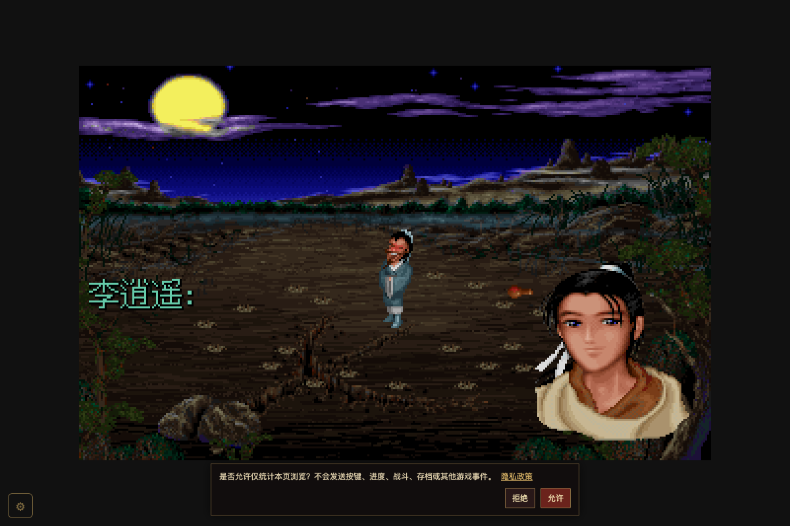
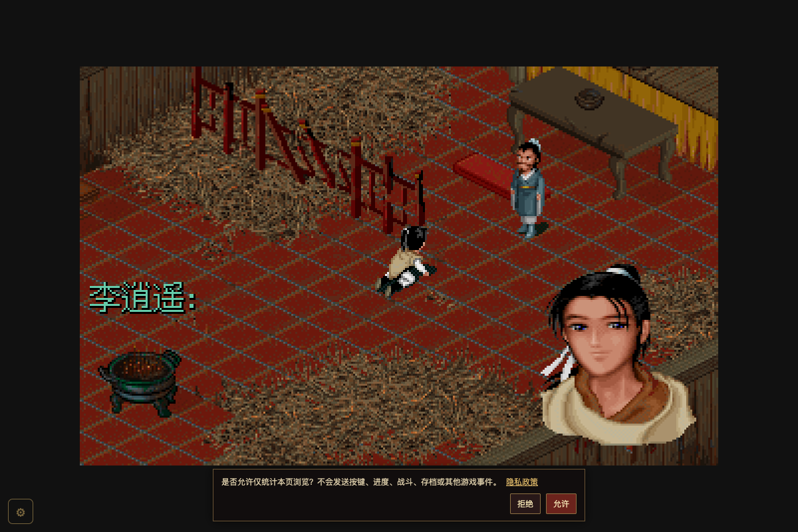

# 酒剑仙传功后场景恢复证据

上级：[任务证据](../README.md)。任务：[GAME-RNG-SCENE-RESTORE-1](../../tasks/GAME-RNG-SCENE-RESTORE-1.md)。

2026-10-14，基点 `646c8097034e4bd30a3ebde86cd61d46a2382e8a`，候选源文件 hash 见
[manifest](evidence-manifest.json.raw)。这是第一阶段诊断/修复证据，不替代合法剧情存档的完整 E2E。
用户已授权合并、CI 后部署，当前发布尚未执行。

## 复现与画面

- [旧实现记录](before-browser.json.raw)：新 Chrome profile，`http://localhost:6005/?skip-intro=1&dev-scene=11`，
  仅将人物摆到酒剑仙身边；原生 proximity 触发 `L_2205`，真实资产/播放器/完整传功脚本继续执行。
  2260 redraw 后 rngFrameActive 仍真，2261 普通对话将 dialogPlayingRNG 置真。
- [修复后记录](after-complete-browser.json.raw)：相同入口，2260 清标记/备份，2263 显示庙内跪拜；
  全段结束仍为 scene 12、explore，三项保持状态均已清。
- 操作脚本原件：[reproduce.mjs.raw](reproduce.mjs.raw)。这是调试定位，不把摆放坐标冒充合法路线检查点。

| 修复前 | 修复后 |
|---|---|
|  |  |

[演出结束仍在庙内的画面](after-complete-completed.png)。三个截图已由 Codex 查看；两个浏览器报告的 pageerror 均为空。

## 回归与独立反证

- 初版 3 用例：[red.json.raw](red.json.raw)，两个普通 redraw 分支均在背景像素断言得到 173、期望 0；
  结局保持通过。对应初版测试保存为 [red-test.ts.raw](red-test.ts.raw)，不混称最终 4 用例的执行集合。
- 最终 [4 用例报告](final-regression.json.raw)：普通 redraw 的延时/淡入路径各一；已有正文/无正文的
  RNG 保持路径各一，后续普通样式仍继承保持。实际 interpreter 与 present 执行，替身仅控制媒体 IO 完成。
- [隔离反控回执](guard-counter-report.json.raw)：4 绿 → 去掉 guard、无条件清理 → 恰无正文保持用例业务断言红 → 4 绿。
  原生报告：[baseline](guard-baseline.json.raw)、[mutant](guard-mutant.json.raw)、[restored](guard-restored.json.raw)。
  执行集合一致，命令/cwd/exit/signal/源与测试 hash 完整；原工作树 hash 未变，临时树已精确删除。
  [运行器原件](check-guard.py.raw)保留唯一变更针，非正式产品工具。
- 既有求雨普通对话保持合同由 `event-system.test.ts` 保留，不再复制相同用例。

## 质量与范围

- 最终整包：[原生 JSON 压缩原件](game-final.json.gz)，312 文件 / **3523 测试通过**，0 失败/跳过；
  解压即 Vitest 原始报告。第一轮 [3522 项记录](game-suite.log.gz)对应补 guard 用例前，保留原始计数。
- [typecheck](typecheck.log.gz) 通过；[lint](lint.log.raw) 3995 文件、0 error / warning / info。
- [额外生产 build](build.log.gz)成功；649.68 kB 主包触发一条 >500 kB 的体积提示。
  原始提示如实保留。用户授权发布后静态拆分音频依赖，主包381.03 kB/audio268.03 kB，
  [最终 build](build-split.log.raw)零告警，默认阈值保持。
- 未改第二阶段、生成资产和部署脚本；当前未发送 issue 回复、未发布生产。覆盖率由合入提交 CI 实测。
- 原始 20 个 PlayRNG caller 的独立静态核验支持当前窄修。普通 RNG 背景对话之后再 redraw 的合成序列
  仍涉及现有双重保持语义，不纳入本次“进入对话前 redraw”的修复承诺。

## 发布前生产包检查

- [发布前核对](deploy-preflight.json.raw)：版权声明提交 `fd2c64522` 已在祖先链；线上资源清单和本地字节一致，
  仅发布 app。独立审查另核线上 SW、worklet、soundfont 均与当前 public 字节相同。
- [拆包后实跑](preview-split-smoke.json.raw)：页面无未捕获异常，点击进入后正常客栈画面、MIDI 有非零输出。
  [游戏画面](preview-game.png)、[667×375 版权声明](preview-loading-small.png)均已看图；隐私提示在临时测试 profile 中选择拒绝。
- 额外离线缓存诊断未通过：[拆包前单包对照](preview-single-baseline-smoke.json.raw)同样没有 `/assets/`
  缓存条目、离线 fetch 失败。两个生产包使用同一 SW 与测试流程，说明不是新增 audio chunk 的特有回归。
  [诊断脚本](preview-cache-diagnostic.mjs.raw)和失败原件保留；不把启动/音频通过混称离线通过。
  既有 SW 资源缓存问题不在本次 RNG 修复范围内，尚未修复；离线冷启动原本也不受支持。
